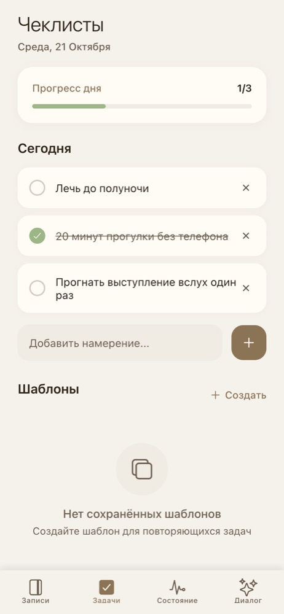
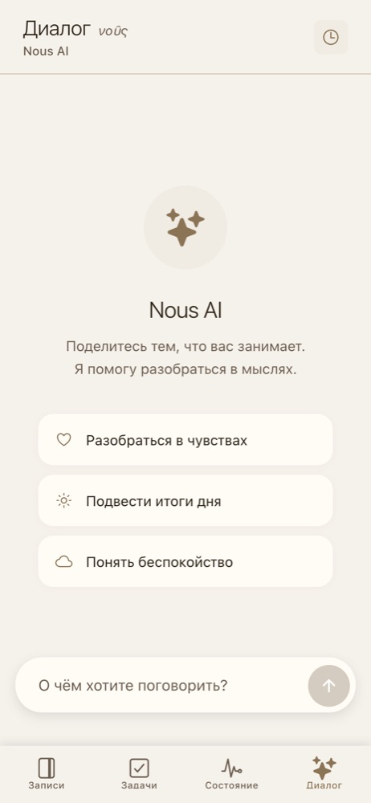

# Nous

Дневник для рефлексии с ИИ-собеседником. Пишешь записи о том, что происходит и что
чувствуешь, ведёшь намерения на день, а ассистент помогает разобраться в мыслях — и
опирается на твои прошлые записи, а не только на текущий разговор.

Работает в браузере как устанавливаемое приложение (PWA) и пишется без сети:
записи сохраняются локально и уходят на сервер, когда связь появляется.

|  |  |  |  |
|---|---|---|---|
| Записи | Редактор | Намерения на день | Диалог |

## Зачем

<!-- ✍️ ТВОЙ ТЕКСТ. 3–5 предложений: почему решил сделать, чем не устроили
     обычные заметки и чат-боты. Удали этот комментарий, когда напишешь. -->

## Что умеет

- **Записи** с автосохранением черновика и поиском.
- **Намерения на день** — чек-лист, который можно собрать из своих шаблонов.
- **Диалог с ассистентом.** В контекст попадают последние записи, а если нужно больше,
  модель сама вызывает инструменты: найти записи по теме, открыть запись за дату,
  предложить шаги — их одной кнопкой можно добавить в чек-лист.
- **Выжимка диалога** — длинный разговор сворачивается в запись дневника.
- **Без сети:** записи и чек-листы правятся офлайн и синхронизируются при подключении.
- Вход по email или через Google, тёмная тема.

## Как устроено

```
Expo (React Native + web) ──REST──▶ FastAPI ──▶ MongoDB (поля записей зашифрованы)
   │                                   └──────▶ OpenAI-совместимый API (tool calling)
   └─ IndexedDB: локальные записи + очередь операций
```

**Офлайн-слой** (`frontend/lib/offline`). Каждое изменение сначала пишется в IndexedDB
и, если сети нет, встаёт в очередь. При подключении очередь отправляется по порядку,
с повторами. Правки записи, которая ещё не дошла до сервера, дописываются в ожидающее
создание, а удаление такой записи убирает её операции из очереди.

**ИИ** (`backend/app/services/ai.py`). Длинная история диалога обрезается, а старая часть
сворачивается в краткое содержание — чтобы не платить за весь разговор в каждом запросе.
Запросы к ИИ ограничены по числу на пользователя в час.

**Шифрование.** Тексты записей, чек-листов и диалогов хранятся в базе зашифрованными
(Fernet). Это шифрование на стороне сервера, не сквозное — подробности и ограничения
в [docs/ENCRYPTION.md](docs/ENCRYPTION.md).

## Что было сложно

<!-- ✍️ ТВОЙ ТЕКСТ. 2–4 пункта: проблема → как решил. Например (если правда было):
     - офлайн-синхронизация: очередь, локальные id, что делать с правками
       до отправки;
     - поиск ИИ по записям, которые лежат в базе зашифрованными;
     - экономия токенов: обрезка истории и саммари;
     - PWA и service worker, кэш после обновлений.
     Удали этот комментарий, когда напишешь. -->

## Стек

**Backend:** Python 3.12, FastAPI, Motor (MongoDB), Pydantic, JWT, cryptography
**Frontend:** Expo 53, React Native, TypeScript, Expo Router, IndexedDB
**Инфраструктура:** Docker Compose, nginx, GitHub Actions

## Запуск

```bash
cp .env.example .env            # заполнить MONGO_PASSWORD, JWT_SECRET, ENCRYPTION_KEY
docker compose up --build       # фронт — http://localhost:3000, API — http://localhost:8000
```

Без `OPENAI_API_KEY` работает всё, кроме ассистента. Без `GOOGLE_CLIENT_ID` — вход
только по email. Деплой на свой сервер — [docs/DEPLOYMENT.md](docs/DEPLOYMENT.md).

<details>
<summary>Без Docker</summary>

```bash
# backend (нужна MongoDB)
cd backend && python3.12 -m venv .venv && source .venv/bin/activate
pip install -r requirements.txt
uvicorn app.main:app --reload            # переменные — из корневого .env

# frontend
cd frontend && yarn install
EXPO_PUBLIC_BACKEND_URL=http://localhost:8000 yarn web
```
</details>

## Тесты

```bash
pip install -r backend/requirements.txt -r tests/requirements.txt
MONGO_URL=mongodb://localhost:27017 pytest -c config/pytest.ini tests
```

API-тесты (`tests/test_api.py`) ходят в запущенный сервер (`API_BASE_URL`), остальные
поднимают приложение прямо в pytest и подменяют ИИ заглушкой: доступ к чужим данным,
поиск по записям, лимиты, вход через Google, шифрование. Офлайн-синхронизацию я
проверял в браузере с отключённой сетью.

## Что дальше

<!-- ✍️ ТВОЙ ТЕКСТ (по желанию). Ограничения, которые я видел:
     - офлайн работает только в браузере: в нативных iOS/Android-сборках нет
       IndexedDB, и офлайн-слой там выключен;
     - конфликты правок с двух устройств не разрешаются — побеждает последняя;
     - ключ шифрования один на всё приложение и не ротируется;
     - экран чата — один компонент на ~1300 строк, его стоит разбить.
     Удали этот комментарий, когда напишешь. -->
